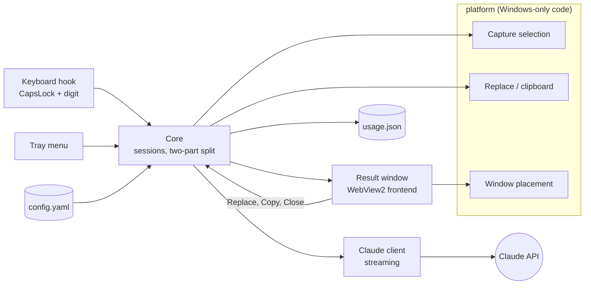
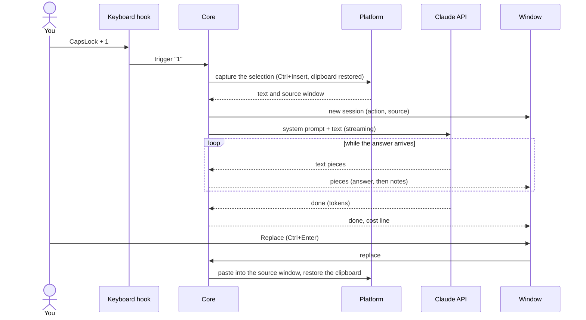

# Architecture overview

How the parts of Spellcast fit together. The pages linked at the end explain each part in detail.

## Components

- The **core** is OS-neutral. It talks to the operating system only through the `platform.Platform` interface and to the window only through events. This keeps it testable with fakes.
- Everything that calls Win32 lives in `internal/platform`. A macOS port would add a second implementation of the same interface.
- The **frontend** is one page with three views: the result window, the API key window and the About window. It gets data from Go as events and never calls Go bindings.

## One request

## Packages

| Package | Responsibility | Details |
|---|---|---|
| `cmd/spellcast` | Wiring: tray menu, notifications, single instance, logging, version, cleanup | |
| `internal/core` | Triggers, sessions, cancelling, two-part answers, Replace text | [How a request works](how-a-request-works.md) |
| `internal/claude` | Claude client, prompts, API key storage, readable errors | [How a request works](how-a-request-works.md) |
| `internal/config` | Loading and validating `config.yaml`, defaults, prices | [Configuration](../reference/configuration.md) |
| `internal/platform` | Keyboard hook, capture, Replace, clipboard, placement, autostart (Windows) | [Keyboard hook](keyboard-hook-and-security.md), [Replace](how-replace-works.md), [Placement](result-window-placement.md) |
| `internal/ui` | The Wails windows and their events | |
| `internal/usage` | Daily totals in `usage.json` | [Check what Spellcast costs](../how-to/check-your-spending.md) |
| `frontend` | TypeScript views: answer rendering, diff, API key, About | |
